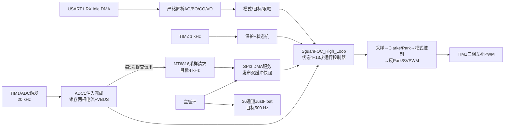
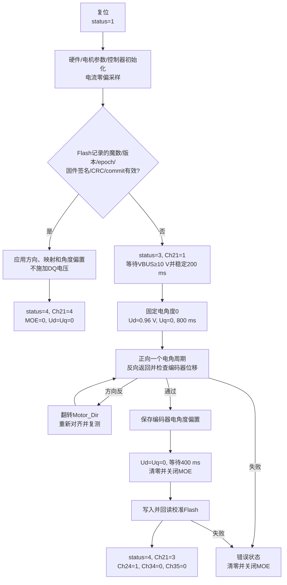

# GIM6010 AI快速接入与开发交接

本文件是新AI或新工程师接手当前GIM6010固件的第一入口。目标是在不依赖历史聊天的情况下，快速建立正确的项目语境、找到关键源码、识别验证边界，并按同一开发闭环继续工作。

- 最后源码审计：2026-08-25。
- 固件目录：`E:\github\GIM6010\SguanFOC库文件`。
- Git仓库根目录：`E:\github\GIM6010`；不要把固件子目录误认为Git根目录。
- 当前分支/HEAD：`main` / `8928aed`，提交信息“能够开环运行”。
- 当前状态：HEAD之后存在大量未提交的用户与协作改动；这些改动必须保留。
- 证据边界：当前源码已通过真实Keil全量构建，装配校准和安全修改仍为`source-confirmed / bench pending`。

## 1. 接手后的五分钟流程

先在固件目录执行只读检查：

```powershell
git rev-parse --show-toplevel
git branch --show-current
git rev-parse --short HEAD
git status --short
```

然后按顺序完成：

1. 阅读本文件，确认当前任务属于分析、代码修改、台架调试、协议修改还是文档整理。
2. 阅读[项目配置档案](project-profile.md)和[阶段状态](stage-status.md)，不要把源码存在的功能等同于台架已经验证。
3. 涉及术语、轴侧或单位时读取[项目术语](CONTEXT.md)；涉及串口或通道时读取[VOFA通信契约](vofa-contract.md)。
4. 用`rg`在当前源码中核对目标宏、结构体、函数、ISR和调用路径；文档不能代替源码审计。
5. 用户明确说“先分析、先列出、不要修改”时只读；用户要求实现或修改时才写文件。
6. 修改前记录脏工作区；修改后核对源码差异、关联文档、真实构建结果和仍缺的台架证据。

完成标准：能够说清“准备改哪个事实源、会影响哪条实时路径、需要同步哪份契约、如何证明没有破坏安全停机”。

## 2. 单一事实来源

按以下优先级处理冲突：

1. 当前源码、`GIM6010_V0.0.ioc`和当前有效Flash装配校准记录。
2. `docs/foc/`中的项目档案、接口契约、阶段状态和实验记录。
3. `资料/文档/`中的专项指南和历史说明。
4. 历史聊天、旧截图和未关联固件身份的数据。

证据标签必须保留：

- `bench-verified`：当前硬件、固件、供电和命令条件下重复通过。
- `source-confirmed`：源码/配置明确，但当前修订尚未完成实物验证。
- `user-reported`：用户观察到，实验身份或原始数据尚不完整。
- `hypothesis`：有预测和验证方法，尚未得到结论。
- `rejected`：已经被实验否定，保留用于避免重复试错。

新AI不得把旧提交“曾经能转”自动外推为当前脏工作区的台架结论，也不得把一台电机的方向/偏置外推到另一台装配。

## 3. 系统边界与当前目标

当前对象是24 V GIM6010减速电机控制器：STM32G431、14极对、8:1减速器、转子侧MT6816编码器、TIM1三相互补PWM、ADC1注入电流/母线采样、USART1连接VOFA。

当前阶段的主目标是：

- 保持纯开环FOC：`Ud=0`，`AO`独立给定`Uq[V]`，`VO`独立给定输出轴机械速度`rad/s`。
- 用速度积分产生开环电角度；编码器在模式0只做观测和进入开环时的平滑接管，不闭合速度环。
- 首次有效母线上电完成装配校准并保存Flash；后续相同固件上电直接加载。
- 先完成预定位、方向、采样、保护和受限开环回归，再进入电流环、速度环和位置环。

以下概念必须分开：

- 当前模式0是开环FOC，不是V/f；源码保留的V/f软限默认关闭。
- `Uq[V]`是开环转矩作用量，不是已标定的`N·m`转矩命令。
- 电机装配校准解决电角度、方向和相线关系；机械臂限位归零属于后续应用层。

## 4. 运行时设计流程



### 4.1 主循环

`Core/Src/main.c`先设置`Sguan.mode = Velocity_OPEN_MODE`、`Sguan.status = MOTOR_STATUS_UNINITIALIZED`，随后持续调用`SguanFOC_main_Loop()`。

`SguanFOC_main_Loop()`负责：

- 服务MT6816 SPI3 DMA，不在20 kHz ISR内阻塞读SPI。
- 执行一次性初始化、Flash加载或首次装配校准。
- 在允许状态下准备并发送VOFA数据。

### 4.2 20 kHz高频路径

`Hardware/Timer.c::HAL_ADCEx_InjectedConvCpltCallback()`锁存ADC注入Rank1/2/3、更新母线、每5周期提交一次编码器请求，然后调用`SguanFOC_High_Loop()`。

正常控制只允许状态4～13。状态14及以上会清零运动目标、写零输出并关闭TIM1 MOE。高频ISR只读取完整编码器快照；SPI事务由主循环启动。

### 4.3 1 kHz低频路径

`Hardware/Timer.c::HAL_TIM_PeriodElapsedCallback(TIM2)`调用`SguanFOC_Low_Loop()`，完成母线/温度保护、状态切换和状态任务。若高频FOC正在计算，本周期低频任务跳过，避免共享数据被并发改写。

### 4.4 串口路径

USART1使用921600-8N1。RX为Receive-to-Idle DMA，回调进入`SguanFOC_Printf_Loop()`；TX为DMA双缓冲，实际成功启动DMA的帧率显示在Ch6。

## 5. 启动与装配校准流程



关键语义：

- 弱电存在但母线低于10 V时只等待，不使能三相桥。
- 当前对齐电压为`0.04×配置VBUS`，24 V配置约0.96 V；不是按不同电机自动辨识出的值。
- 相序检查以编码器方向为机械正方向，当前自动修正的是`Motor_Dir`，不是任意重排所有PWM和电流通道。
- 校准过程中存在阻塞式延时，Ch21=`2`可能无法被上位机实时看到；完成后应读取最终结果。
- 保存后必须是`Ud=Uq=0`、MOE=0，电机轴应可轻松转动。
- 当前固件签名参与校准有效性判断；程序区发生变化通常会使旧记录失效。相同HEX重复上电可继续加载原记录。
- 更换电机、三相接线、编码器安装关系或校准数据结构时，应递增`USER_CALIBRATION_EPOCH`并重新校准。

## 6. 控制模式与输入输出

| 模式 | `BO`范围 | `AO`语义 | `VO`语义 | 当前验证状态 |
|---|---:|---|---|---|
| 0 开环FOC | `<1` | `Uq[V]`，限幅为配置母线的±0.35倍 | 输出轴速度`rad/s`，限幅±30.787608 | 旧修订用户确认；当前修订待回归 |
| 1 电流环 | `1～<2` | 目标`Iq[A]`，普通命令限幅±6.6 A | 不使用 | 源码存在，台架未通过 |
| 2 速度-电流双环 | `2～<3` | 输出轴目标速度`rad/s` | 不使用 | 源码存在，台架未通过 |
| 3 位置-速度-电流三环 | `≥3` | 目标位置`rad` | 不使用 | 源码存在，参考轴与台架性能未通过 |

开环模式0的数据关系：

```text
AO → 限幅 → Uq[V]
VO[输出轴 rad/s] → ×8 → 电机轴 rad/s → ×14 → 电角速度 rad/s
电角速度 × 50 us → 累加电角度 → 0～2π取模 → SVPWM
每个20 kHz周期强制Ud=0
```

`CO<0.5`是显式停机：全部目标清零、状态转入STANDBY并关闭PWM。`CO≥0.5`请求重新进入初始化流程，但仍受母线、编码器、校准和故障门控。

## 7. 状态与安全门控

- 状态0：STANDBY，停机且MOE关闭。
- 状态1～3：未初始化、初始化、装配校准；普通运动命令被拒绝且不缓存。
- 状态4～13：正常控制运行区；只有这些状态允许高频控制计算。
- 状态14～23：过压、欠压、温度、电流、编码器、传感器、PWM、急停或失能故障区；必须清零输出并关闭MOE。
- 欠压低于12 V需连续20 ms确认；过压高于48 V最多1 ms确认；恢复使用1 V滞环并稳定1 s，随后只进入STANDBY。
- 普通运行时`|Ud|`和`|Uq|`均小于0.02 V会关闭MOE，使电机进入高阻空闲。

完整状态码以`SguanFOC/Sguan_MotorStatus.h`为准。涉及PWM、ADC、母线、相序、Flash或故障路径的改动，必须先证明零输出和停机路径，再讨论运动性能。

## 8. VOFA快速核对

完整定义只维护在[VOFA通信契约](vofa-contract.md)。接手当前校准问题时优先观察：

- Ch0：状态码。
- Ch12：滤波后母线电压。
- Ch21：等待/运行/新保存/Flash加载/失败结果码。
- Ch22：本次实际上电施加的对齐Ud。
- Ch23：相序检查最终结果。
- Ch24：校准Flash有效。
- Ch25：母线ADC是否已有有效样本。
- Ch26：复位后未滤波母线最小值。
- Ch34：TIM1 MOE；待机、校准完成和故障时必须为0。
- Ch35：当前Ud；预定位释放后必须为0。

协议固定为36个小端`float`加`00 00 80 7F`，共148 byte，目标500 Hz。下行只接受`AO/BO/CO/VO=<普通十进制浮点数>?`。`%f`、NaN、Inf、科学计数法、残缺和超长命令必须无副作用拒绝。

## 9. 关键文件索引

### 9.1 工程、外设和调度

| 文件 | 关键内容 | 修改时必须同步核对 |
|---|---|---|
| `GIM6010_V0.0.ioc` | MCU、引脚、时钟、ADC、TIM、SPI、UART、DMA的CubeMX真值 | 生成后的`Core/Src`、引脚文档、实际时钟 |
| `Core/Src/main.c` | 外设启动、初始模式/状态、主循环入口 | 启动顺序、TIM1/TIM2重复启动风险 |
| `Core/Src/usart.c` | USART1 921600-8N1配置 | `.ioc`、VOFA契约、DMA配置 |
| `Core/Src/adc.c`、`tim.c` | CubeMX生成的触发、Rank、PWM和定时器配置 | `.ioc`与示波器/ADC时序证据 |
| `Hardware/Timer.c/.h` | 20 kHz ADC回调、1 kHz Low Loop、UART DMA回调、执行时间计数 | ISR预算、并发、DMA所有权 |
| `MDK-ARM/GIM6010_V0.0.uvprojx` | Keil目标、编译器、源文件清单 | 新增`.c`是否进入真实构建 |

### 9.2 BSP与硬件适配

| 文件 | 关键内容 | 修改时必须同步核对 |
|---|---|---|
| `BSP/BSP_MT6816.c/.h` | SPI3 DMA、14 bit角度、双缓冲、4 kHz目标、陈旧检测、方向 | 编码器方向、跨零、样本年龄、ISR禁止阻塞 |
| `BSP/BSP_ADC.c/.h` | 母线比例、滤波、有效标志、启动最小值 | 万用表标定、欠压/过压门限 |
| `SguanFOC/UserData_Function.h` | SguanFOC到ADC/编码器/PWM/UART/延时的板级适配 | PWM极性、MOE、零矢量和硬件故障路径 |

### 9.3 FOC、参数和协议

| 文件 | 关键内容 | 修改时必须同步核对 |
|---|---|---|
| `SguanFOC/SguanFOC.c/.h` | 全局`Sguan`、四模式、状态机、保护、安全清零、装配校准 | 高频/低频并发、状态范围、故障输出 |
| `SguanFOC/UserData_Config.h` | 20 kHz/4 kHz/500 Hz、减速比、额定值、速度限幅、校准和保护时序 | `project-profile.md`、Flash epoch、带宽 |
| `SguanFOC/UserData_Motor.h` | 电气参数、方向默认值、电流映射、母线/电流/温度阈值 | 实测参数、校准记录、方向不可外推 |
| `SguanFOC/UserData_Parameter.h` | 电流、速度、位置控制器参数及输出限幅 | 电流比例、控制周期、抗饱和和台架记录 |
| `SguanFOC/UserData_UserControl.h` | AO/BO/CO/VO语义、开环角积分、模式限幅、36通道 | `vofa-contract.md`、速度轴侧与单位 |
| `SguanFOC/Sguan_printf.c/.h` | 严格ASCII解析、JustFloat打包、TX DMA双缓冲、Ch6帧率 | `CH_COUNT`、总帧长度、UART带宽 |
| `SguanFOC/UserData_Calibration.c/.h` | Flash地址、记录格式、签名、CRC、commit、读写 | 链接脚本保留页、epoch、掉电完整性 |
| `SguanFOC/Sguan_MotorStatus.c/.h` | 状态码和状态回调分发 | VOFA Ch0、运行/故障边界 |
| `SguanFOC/Sguan_SVPWM.c/.h` | 反Park和SVPWM | 电角度方向、PWM相序、母线归一化 |
| `SguanFOC/Sguan_PID.c`、`Sguan_STA.c` | 电流/速度/位置控制器 | 闭环阶段台架测试与稳定裕量 |

### 9.4 文档与证据

| 文件/目录 | 用途 |
|---|---|
| `docs/foc/project-profile.md` | 当前参数、来源、单位、验证状态和未知项 |
| `docs/foc/vofa-contract.md` | 串口、命令、通道和带宽的唯一合同 |
| `docs/foc/stage-status.md` | 当前最高可信阶段和下一阶段门控 |
| `docs/foc/debug-records/` | 单次现象、假设、实验、根因与回归 |
| `docs/foc/calibrations/` | 具体控制板/电机/编码器/接线的Flash校准身份 |
| `docs/adr/` | 难以逆转且存在真实取舍的设计决策 |
| `资料/文档/` | 专项指南和历史背景；使用前必须与当前源码核对 |

## 10. 按修改对象选择入口

- 改电机参数、极对数、减速比、方向或额定限制：先看`UserData_Config.h`、`UserData_Motor.h`、`project-profile.md`，再判断校准epoch是否必须变化。
- 改开环FOC或控制模式：先看`UserData_UserControl.h`和`SguanFOC.c`，再核对轴侧、单位、状态门控和Ch13/Ch18。
- 改预定位、相序或Flash：先看`SguanFOC.c`的`Sguan_Start_Tick`、`UserData_Calibration.*`和ADR 0003，再设计失败安全测试。
- 改ADC/电流/母线：先看`.ioc`、`adc.c`、`Hardware/Timer.c`、`BSP_ADC.*`和`UserData_Function.h`，用仪表数据校准而不是只看软件值。
- 改编码器：先看`.ioc`、`BSP_MT6816.*`和20 kHz请求/主循环DMA所有权，禁止在ISR内改成阻塞SPI。
- 改VOFA：先看`vofa-contract.md`、`UserData_UserControl.h`、`Sguan_printf.*`和`usart.c`；新增通道只能从末尾追加。
- 改闭环参数：先确认Stage 0～6已经通过；未验证电流符号和比例时不进入电流环整定。
- 改机械臂归零：作为应用层新模块设计，不把机械限位零位写进电机电角度校准。

## 11. 统一开发闭环

### 11.1 只读分析

1. 复述现象、预期、固件身份、硬件条件和原始数据路径。
2. 从源码建立调用链，列出“已确认/假设/缺证据”。
3. 为每个假设写出可区分的VOFA通道、示波器点或仪表结果。
4. 用户只要求分析时停止在修改清单，不写源码或文档。

### 11.2 获得修改授权后

1. 多步骤工作先在`docs/superpowers/plans/`记录文件、顺序和验证。
2. 保留用户未提交改动，只修改任务直接需要的文件。
3. 保持SguanFOC现有命名、结构和用户层入口；避免无关重构。
4. 所有代码增删写有意义的中文备注，说明目的、单位、方向、限幅或安全原因；删除逻辑在邻近代码或修改说明记录原因。
5. 修改协议、参数、启动、Flash、校准或状态时同步更新对应权威文档。
6. 嵌入式变更检查ISR耗时、共享变量、DMA缓冲所有权、溢出、符号、失效输入和安全停机。

### 11.3 构建与静态验证

从`MDK-ARM`目录执行当前真实Keil全量构建：

```powershell
& 'C:\Users\18261\AppData\Local\Keil_v5\UV4\UV4.exe' `
  -r '.\GIM6010_V0.0.uvprojx' -j0 `
  -o '.\GIM6010_V0.0\ai_rebuild.log'
```

随后核对：

```powershell
Select-String -Path '.\GIM6010_V0.0\ai_rebuild.log' -Pattern 'Error|Warning|Program Size'
Get-FileHash -Algorithm SHA256 '.\GIM6010_V0.0\GIM6010_V0_0.hex'
git diff --check
git status --short
```

只有真实构建日志出现0 Error、0 Warning，才能写“编译通过”。构建通过仍不等于烧录或台架通过。

### 11.4 台架验证

台架操作由用户执行。AI提供明确的前置条件、命令阶梯、观察通道、通过标准和立即停机条件，不远程假定电机已经安全固定。

任何带电步骤至少记录：控制板/电机/编码器身份、Git/HEX身份、母线和限流、负载、命令、VOFA通道、实际观测、原始数据路径、重复次数和结论。

出现电源过流保护、异常噪声、剧烈抖动、失控转动、机械碰撞风险、Ch34在故障中仍为1或温升异常时，立即撤销母线并保留现场数据。

## 12. 当前交接卡

### 已确认

- 源码是纯开环FOC语义：`Ud=0`、`AO→Uq[V]`、`VO→输出轴rad/s→电角度积分`。
- USART1为921600-8N1；VOFA为36通道、148 byte、目标500 Hz。
- TIM1/ADC高频环20 kHz，TIM2低频环1 kHz，MT6816目标缓存4 kHz。
- 最新全量构建使用Arm Compiler 6.23，`Code=53546`、`RO-data=2814`、`RW-data=52`、`ZI-data=5276`、0错误、0警告。
- 当前HEX SHA-256为`10368D03DFBD9E6111E8F10F2C0222C0D43DE2D1924D84C27C208F07A07FD644`。

### 最近现象与源码响应

- 用户曾观察复位后Ch0约2 s为15后变0，Ch12约23.15 V而万用表约24 V，未看到电机预定位。
- 状态15是欠压、0是待机；首次有效校准最短约3.2 s，因此该现象支持旧Flash记录被加载并跳过预定位，同时暴露旧欠压恢复逻辑问题。
- 当前源码已加入欠压连续20 ms确认、恢复滞环、安全停机和Ch21～Ch35诊断；修改已编译，尚未完成当前硬件回归。

### 下一单步目标

烧录当前HEX并把VOFA设置为36通道，在受限母线和机械安全条件下验证：

1. 新校准时Ch21最终为3、Ch22约0.96、Ch23为1、Ch24为1、Ch34为0、Ch35为0。
2. 后续同固件掉电重启时无预定位动作，Ch21为4、Ch22为0、Ch24为1、Ch34为0。
3. 记录Ch0、Ch12、Ch21～Ch26、Ch34、Ch35的完整时间序列以及电源限流/是否触发保护。

完成这一步之前，不进入电流环、速度环或位置环调参。

## 13. 给下一位AI的请求模板

```text
你正在接手GIM6010电机控制器工程。
工程目录：E:\github\GIM6010\SguanFOC库文件

开始前请完整阅读：
1. AGENTS.md
2. docs/foc/ai-development-handoff.md
3. docs/foc/project-profile.md
4. docs/foc/stage-status.md
5. 与本任务相关的VOFA契约/调试记录/ADR

先执行git status并检查当前源码，不覆盖未提交改动。
本次授权类型：[仅分析 / 允许修改代码和文档]
本次任务：[写明目标]
硬件与固件身份：[控制板、电机、编码器、HEX或Git]
现象与原始数据：[VOFA/示波器/电源/视频路径]

请按“已确认、假设、缺证据、修改或实验、验证结果、剩余风险”输出。
所有代码增删写中文备注；代码修改后核对相关文档和真实Keil编译结果。
```

## 14. 文档维护触发

- 参数、单位、轴侧、方向、引脚、频率、限幅变化：更新`project-profile.md`。
- 串口、命令、通道、帧长或发送频率变化：更新`vofa-contract.md`。
- 编译、烧录、带电实验、故障复现或假设否定：更新`debug-records/`和`stage-status.md`。
- 生成、读取、失效或更换装配校准：更新`calibrations/`。
- 出现难以逆转且存在真实取舍的决策：新增或替代`docs/adr/`。
- 关键入口或开发闭环变化：更新本文件和根目录`AGENTS.md`指针。

本文件只承担接入、路由和流程编排。详细参数、完整VOFA通道、单次实验和设计理由继续由各自权威文档维护，避免形成多份相互漂移的副本。
