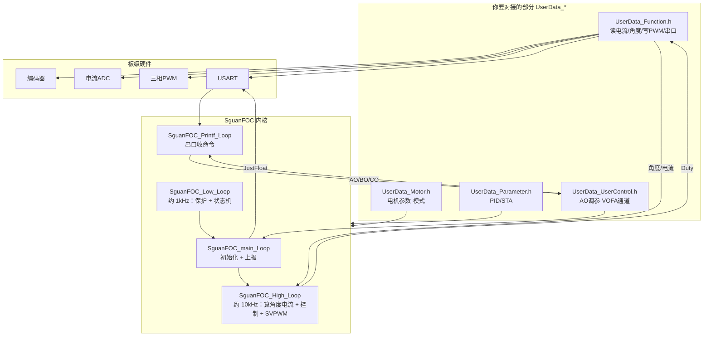
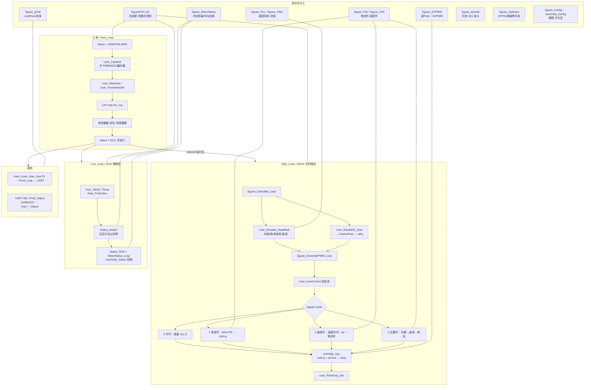

# GIM6010 SguanFOC 库设计逻辑框图

> 工程：`E:\github\GIM6010\SguanFOC库文件`  
> 库目录：`SguanFOC/`  
> 目的：用「简单 + 复杂」两套框图说明 SguanFOC 的整体设计思路  
> 修订：2026-08-02

---

## 目录

1. [一句话总览](#1-一句话总览)
2. [图一：简单逻辑框图](#2-图一简单逻辑框图)
3. [图二：复杂逻辑框图](#3-图二复杂逻辑框图)
4. [库文件分工](#4-库文件分工)
5. [四档控制模式](#5-四档控制模式)
6. [与开环 / VOFA 的对应关系](#6-与开环--vofa-的对应关系)
7. [修订记录](#7-修订记录)

---

## 1. 一句话总览

SguanFOC 的核心设计是：

**用户只填写 `UserData_*` 硬件接口与参数；库通过三档周期任务完成「采样 → 控制 → SVPWM → 保护/通信」。**

| 任务 | 典型频率 | 入口函数 | 职责 |
|------|----------|----------|------|
| 主循环 | 尽量快转 | `SguanFOC_main_Loop()` | 上电初始化 + JustFloat 上报 |
| 高频环 | ~10 kHz | `SguanFOC_High_Loop()` | 角度/电流计算 + 模式控制 + SVPWM |
| 低频环 | ~1 kHz | `SguanFOC_Low_Loop()` | 母线/温度保护 + 状态机 |
| 串口事件 | Idle 触发 | `SguanFOC_Printf_Loop()` | 解析 AO/BO/CO 等下行命令 |

全局数据对象：`Sguan`（类型 `SguanFOC_System_STRUCT`，定义于 `SguanFOC.h`，实例在 `SguanFOC.c`）。

---

## 2. 图一：简单逻辑框图

适合先建立整体印象：**用户层 ↔ 内核三任务 ↔ 硬件**。



### 读法

1. **左边**：你填的“插头”（板级差异都收敛在这里）。  
2. **中间**：库用不同频率切分实时控制与慢速逻辑。  
3. **右边**：电机与通信硬件。  
4. **开环**：High_Loop 使用 `Uq_in` + 电角度做 SVPWM。  
5. **闭环**：同一骨架内增加 PID/STA，不改整体调度结构。

---

## 3. 图二：复杂逻辑框图

适合深入理解：**文件模块、上电流程、High/Low 内部数据流、通信**。



### 设计要点

#### （1）分层清晰

| 层 | 内容 | 原则 |
|----|------|------|
| 用户层 | `UserData_*.h` | 板级差异、参数、调参；不碰库算法内核 |
| 算法/调度层 | `Sguan_*.c` | FOC、滤波、状态机、通信协议 |
| 硬件层 | HAL / BSP | 由用户在 `UserData_Function` 或 BSP 中封装 |

#### （2）时间切片

- **High**：必须短；用 `PWM_Calc` 标志做互斥/看门狗，超时可进 `PWM_CALC_FAULT`。  
- **Low**：保护与状态机，可稍慢；若 High 正在算则本次 Low 可跳过。  
- **main**：初始化一次 + 持续 JustFloat 发送。

#### （3）模式用函数表分发

`SguanFOC.c` 内 `Control_Tick[mode]`：

| mode | 宏 | 控制函数 |
|:----:|----|----------|
| 0 | `Velocity_OPEN_MODE` | `Control_Velocity_OPEN` |
| 1 | `Current_SINGLE_MODE` | `Control_Current_SINGLE` |
| 2 | `VelCur_DOUBLE_MODE` | `Control_VelCur_DOUBLE` |
| 3 | `PosVelCur_THREE_MODE` | `Control_PosVelCur_THREE` |

四种模式算完 `Ud_in/Uq_in` 后，**共用** `SVPWM_Tick` → `User_PwmDuty_Set`。

#### （4）状态机门槛

High 中真正跑控制的条件（概念上）：

```text
status > 3 && status < 19   → 运行区（含 IDLE、各运行态、部分保护态处理）
status < 4                  → 未就绪，开环会把 Uq 清零等
status 故障锁定区           → 电压给定清零、停转逻辑
```

常见状态定义见 `Sguan_MotorStatus.h`（如 `UNINITIALIZED=1`、`IDLE=4`）。

#### （5）全局对象 `Sguan`

主要子结构：

| 成员 | 含义 |
|------|------|
| `motor` | 极对数、VBUS、Duty、方向等 |
| `identify` | Ld/Lq/Rs/Flux |
| `foc` | Target_*、Ud/Uq、Duty_u/v/w |
| `current` | Id/Iq、偏置、相电流 |
| `encoder` | 角度、速度、偏置 |
| `safe` | VBUS_MAX/MIN、过流阈值等 |
| `control` | PID/STA 实例 |
| `TXdata` | JustFloat 12 通道 |
| `status` / `mode` | 状态机 / 控制模式 |

---

## 4. 库文件分工

| 文件 | 职责 |
|------|------|
| `SguanFOC.c` / `.h` | 总入口、Calculate/GeneratePWM、四模式、High/Low/main |
| `Sguan_SVPWM.c` | 逆 Park、扇区、占空比 |
| `Sguan_PID.c` | 电流/速度/位置 PI（可选） |
| `Sguan_STA.c` | 速度环超螺旋/STA（可选） |
| `Sguan_PLL.c` | 角度相关速度观测 |
| `Sguan_Filter.c` | 低通等滤波 |
| `Sguan_MotorStatus.c` | 状态码与 `MOTOR_STATUS_xxx_Loop` 分发 |
| `Sguan_printf.c` | JustFloat 帧、AO/BO/CO 解析 |
| `Sguan_IQmath.c` | Q31 定点（`Open_Q31_Calculate`） |
| `Sguan_Optimize.c` | MTPA/弱磁等可选优化 |
| `Sguan_Config.h` | 由 `UserData_Config.h` 宏导入 |
| `UserData_Function.h` | **必须对接**：ADC/编码器/PWM/串口/延时 |
| `UserData_Motor.h` | 电机与安全参数 |
| `UserData_Parameter.h` | 控制器参数 |
| `UserData_UserControl.h` | 实时给定、VOFA 通道、AO/BO/CO |
| `UserData_Status.h` | 状态机信号与各状态回调（灯效等） |
| `UserData_Config.h` | 控制周期 `TIM_T`、Debug/PI/Q31 开关 |

---

## 5. 四档控制模式

```text
给定
  │
  ├─ mode0 开环 ─────────────► Uq_in（人工/VOFA）
  ├─ mode1 电流环 ───────────► Target_Iq → 电流PID → Uq
  ├─ mode2 速度-电流 ────────► Target_Speed → 速度环 → Iq* → 电流PID → Uq
  └─ mode3 位置-速度-电流 ───► Target_Pos → … → Uq
                    │
                    ▼
              SVPWM_Tick(Ud,Uq,θ)
                    │
                    ▼
              User_PwmDuty_Set(Du,Dv,Dw)
```

开环调试时：重点保证「角度可读 + PWM 可写 + `Uq_in` 可设」，电流环接口可后补。

---

## 6. 与开环 / VOFA 的对应关系

### 6.1 开环数据路径

```text
Sguan.mode = Velocity_OPEN_MODE
Sguan.foc.Uq_in = 2.4f   （或 VOFA AO=2.4?）
        │
        ▼
High_Loop
  → Sguan_Calculate_Loop   （User_Encoder_ReadRad → 电角度）
  → Control_Velocity_OPEN  （运行态下保持 Uq_in）
  → SVPWM_Tick
  → User_PwmDuty_Set       （必须实现，否则不转）
```

### 6.2 VOFA 上下行

```text
上行：main_Loop → User_UserTX → Printf_Loop → UART TX DMA → VOFA
下行：UART Idle → Printf_Adjust → User_AO_Adjust → Sguan.foc.Uq_in
```

开环时 VOFA 建议关注：

| 通道 | 典型内容 |
|:----:|----------|
| Ch7 | `Uq_in` |
| Ch9/10 | 机械角 rad/deg |
| Ch11 | `mode`（开环应为 0） |
| Ch0 | `status`（运行后应 ≥ IDLE=4） |

### 6.3 常见断点（对照复杂图）

| 断点 | 结果 |
|------|------|
| `User_PwmDuty_Set` 为空 | SVPWM 算了但电机不转 |
| ADC 注入未启动，High_Loop 不进 | 控制环不刷新 |
| `User_AO_Adjust` 未实现 | VOFA 发 AO 无效 |
| `status` 一直 &lt; 4 | 开环会把 `Uq_in` 清零 |
| 编码器未 Init / 读角失败 | 电角度错，抖动或不转 |

---

## 7. 修订记录

| 日期 | 说明 |
|------|------|
| 2026-08-02 | 初版：简单/复杂两套 Mermaid 框图 + 文件分工与开环/VOFA 对照 |

---

<p align="center"><b>SguanFOC：UserData 接硬件，三环任务跑控制，模式表切换开环到三环</b></p>
